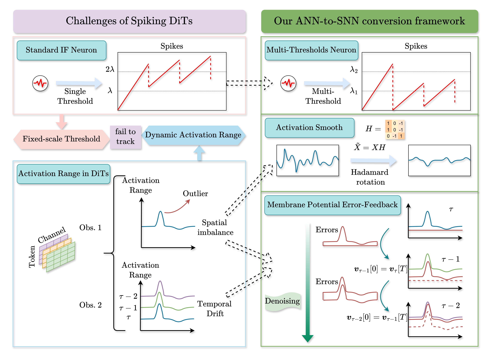

<div align="center">

# SpikingDiT

### Trajectory-Aware Spiking DiTs Conversion via Membrane Potential Error-Feedback

[](https://icml.cc/virtual/2026/poster/61672)
[](https://openreview.net/forum?id=nsd26wlIGP)
[](https://www.python.org/)
[](https://pytorch.org/)
[](LICENSE)

**[Paper](https://icml.cc/virtual/2026/poster/61672)** ·
**[OpenReview](https://openreview.net/forum?id=nsd26wlIGP)** ·
**[BibTeX](#citation)**

[Haoran Fang](https://github.com/JustVelkhana)<sup>1</sup> ·
Tianxing Man<sup>2</sup> ·
Xingchen Li<sup>1</sup> ·
Wanli Shi<sup>1</sup> ·
Jinjie Fang<sup>1</sup> ·
[Bin Gu](mailto:gubin@jlu.edu.cn)<sup>1✉</sup>

<sup>1</sup> School of Artificial Intelligence, Jilin University<br>
<sup>2</sup> College of Computer Science, Inner Mongolia University

</div>

---

## News

- **2026.07** &nbsp; SpikingDiT is accepted to **ICML 2026**. Code and citation are released in this repository.

## Abstract

Diffusion Transformers (DiTs) deliver state-of-the-art image generation, but iterative denoising is computationally expensive. Spiking Neural Networks (SNNs) offer an energy-efficient alternative, yet training them from scratch is difficult. This repository implements a **training-free ANN-to-SNN conversion** framework for DiTs.

We identify a DiT-specific failure mode: fixed-scale spiking neurons cannot track the **dynamic activation range** along the denoising trajectory, so conversion error accumulates and generation quality collapses. SpikingDiT addresses this with:

- **Multi-Threshold (MT) neurons** that fire at multiple levels and expand spike expressiveness
- **Membrane Potential Error-Feedback (MPEF)** that recycles residual membrane potential across adjacent denoising steps
- **Hadamard rotation** that smooths activation outliers before conversion

On ImageNet, the converted Spiking DiT approaches full-precision DiT-XL/2 quality at **T = 4** simulation steps, while replacing most MACs with cheap accumulate operations.

## Method

<p align="center">
  
</p>
<p align="center"><em>Overview of the conversion challenge and our ANN-to-SNN framework (MT neurons + Hadamard smoothing + MPEF).</em></p>

## Visual Results

ImageNet 256×256, classifier-free guidance 1.5, 50 denoising steps. All spiking models use **T = 4**, **n = 6**.

| Original DiT (ANN) | Naive Conversion | Ours (MT + MPEF) |
| :---: | :---: | :---: |
|  |  |  |

Naive conversion drifts off the generative trajectory. MPEF keeps residual membrane potential across denoising steps and recovers images that are close to the ANN baseline.

## Highlights

- **Training-free**: convert a pretrained DiT-XL/2 into a spiking model without fine-tuning
- **Low latency**: T = 4 SNN steps with n ∈ {6, 8, 10} thresholds
- **Near-lossless FID**: 5.86 vs. 5.75 (ANN) on ImageNet 256×256 at 50 steps, cfg = 1.5
- **Energy-aware compute**: most multiply-accumulates are replaced by accumulates

## Installation

The original development environment is recorded in `environment.yml`. For a lighter setup:

```bash
conda create -n spikingdit python=3.10 -y
conda activate spikingdit
pip install -r requirements.txt
```

Install [fast-hadamard-transform](https://github.com/Dao-AILab/fast-hadamard-transform) (used for activation smoothing):

```bash
git clone https://github.com/Dao-AILab/fast-hadamard-transform.git
cd fast-hadamard-transform
pip install -e . --no-build-isolation
cd ..
```

Download pretrained DiT weights from Hugging Face:

```bash
huggingface-cli download facebook/DiT-XL-2-256
huggingface-cli download facebook/DiT-XL-2-512
```

Calibration uses a few ImageNet validation labels (`ILSVRC/imagenet-1k`). Accept the dataset terms on Hugging Face and log in if needed:

```bash
huggingface-cli login
```

### Evaluation environment (FID / sFID / IS)

Metric computation uses a separate TensorFlow environment, following [ADM](https://github.com/openai/guided-diffusion):

```bash
conda create -n evaluator python=3.9 -y
conda activate evaluator
pip install tensorflow-gpu==2.10.0 scipy tqdm requests
```

Place the Inception graph at `evaluations/classify_image_graph_def.pb` (downloaded automatically on first run if missing). ImageNet reference batches are the standard ADM files, e.g. `VIRTUAL_imagenet256_labeled.npz`.

## Usage

### 1. Sample a few images

Generate class-conditional images (classes 0–49) with MT neurons and MPEF:

```bash
bash sample.sh <gpu> <T> <n> <steps> <image_size>
# example
bash sample.sh 0 4 8 50 256
```

Images are written to `outputs_images/`.

Equivalent Python command:

```bash
CUDA_VISIBLE_DEVICES=0 python main.py \
  --model_name facebook/DiT-XL-2-256 \
  --pre_rotate --down_online_had \
  --use_spike --use_mem \
  --T 4 --num_thresholds 8 \
  --steps 50 --act_steps 50 \
  --cfg 1.5 \
  --out_image_dir ./outputs_images/demo
```

Use `--local_files_only` if the DiT weights are already cached and you do not want a network fetch.

### 2. Generate 10k images for evaluation

```bash
bash main.sh <gpu> <T> <n> <steps> <image_size>
# example: T=4, n=8, 50 denoising steps, 256px
bash main.sh 0 4 8 50 256
```

This launches one process per visible GPU, samples 10 images per ImageNet class (10,000 total), and saves `samples_10k.npz` under `outputs/`.

Recommended settings from the paper: **T = 4**, **n = 6 / 8 / 10**, **steps = 25 / 50 / 100**, **image_size = 256 / 512**.

### 3. Compute metrics

```bash
conda activate evaluator
python evaluations/evaluator.py \
  /path/to/VIRTUAL_imagenet256_labeled.npz \
  ./outputs/256/SNN_T=4,n=8,mem,step50/samples_10k.npz
```

## Results

All SpikingDiT numbers below use **T = 4**. Metrics are computed on 10k ImageNet samples.

### ImageNet 256×256, cfg = 1.5

| Steps | Method | Setting | IS ↑ | FID ↓ | sFID ↓ | Prec ↑ |
| :---: | :--- | :--- | :---: | :---: | :---: | :---: |
| 25 | FP DiT-XL/2 | W16A16 | 178.88 | 5.96 | 23.79 | 0.82 |
| 25 | Q-DiT | W8A8 | 213.52 | 7.40 | 21.50 | 0.77 |
| 25 | **Ours** | n = 8 | 175.81 | **5.99** | 23.48 | 0.81 |
| 50 | FP DiT-XL/2 | W16A16 | 182.20 | 5.75 | 22.36 | 0.81 |
| 50 | Q-DiT | W8A8 | 231.47 | 6.16 | 19.07 | 0.80 |
| 50 | **Ours** | n = 6 | 160.33 | 5.86 | 20.41 | 0.76 |
| 50 | **Ours** | n = 8 | 181.38 | **5.59** | 21.61 | **0.82** |
| 100 | FP DiT-XL/2 | W16A16 | 181.03 | 5.56 | 21.21 | 0.82 |
| 100 | **Ours** | n = 8 | 182.50 | **5.46** | 20.84 | 0.81 |

### ImageNet 512×512, cfg = 1.5

| Steps | Method | Setting | IS ↑ | FID ↓ | sFID ↓ | Prec ↑ |
| :---: | :--- | :--- | :---: | :---: | :---: | :---: |
| 25 | FP DiT-XL/2 | W16A16 | 156.63 | 6.40 | 21.92 | 0.84 |
| 25 | **Ours** | n = 10 | 150.62 | **6.39** | 21.20 | 0.83 |
| 50 | FP DiT-XL/2 | W16A16 | 159.16 | 6.01 | 21.28 | 0.84 |
| 50 | **Ours** | n = 8 | 155.02 | **5.91** | 19.72 | 0.83 |

### Ablation on DiT-XL/2-256 (T = 4, n = 6, 25 steps)

| Setting | IS ↑ | FID ↓ | sFID ↓ | Prec ↑ |
| :--- | :---: | :---: | :---: | :---: |
| ANN | 178.88 | 5.96 | 23.79 | 0.82 |
| Naive conversion | 4.23 | 198.03 | 295.66 | 0.05 |
| + Hadamard | 91.48 | 18.47 | 34.89 | 0.65 |
| + MPEF | 144.67 | 7.01 | 20.22 | 0.72 |
| + Both | **149.95** | **6.52** | 22.01 | **0.75** |

### Operations on DiT-XL/2-256

| Config | MACs (G) | ACs (G) |
| :--- | ---: | ---: |
| ANN | 118.69 | 0.09 |
| T = 4, n = 6 | 0.91 | 482.05 |
| T = 4, n = 8 | 0.91 | 487.24 |

Full tables, cfg = 1.0 results, and additional visualizations are in the paper.

## Project Structure

```text
SpikingDiT/
├── main.py                 # conversion, sampling, and 10k generation
├── main.sh                 # multi-GPU 10k-sample evaluation
├── sample.sh               # quick visualization samples
├── SNN/
│   ├── spike_neuron.py     # multi-threshold neuron + MPEF
│   ├── spike_layer.py      # spiking DiT blocks
│   └── change_spike_states.py
├── utils/                  # Hadamard rotation, calibration, wrapping
├── evaluations/            # ADM-style FID / sFID / IS evaluator
├── assets/                 # figures used in this README
├── citation.bib            # BibTeX
└── CITATION.cff            # GitHub citation metadata
```

## Citation

If you find this repository or paper useful, please cite:

```bibtex
@inproceedings{fang2026trajectory,
  title     = {Trajectory-Aware Spiking {DiTs} Conversion via Membrane Potential Error-Feedback},
  author    = {Fang, Haoran and Man, Tianxing and Li, Xingchen and Shi, Wanli and Fang, Jinjie and Gu, Bin},
  booktitle = {Proceedings of the 43rd International Conference on Machine Learning},
  series    = {Proceedings of Machine Learning Research},
  volume    = {306},
  year      = {2026},
  address   = {Seoul, South Korea},
  publisher = {PMLR}
}
```

A machine-readable version is also provided in [`citation.bib`](citation.bib) and [`CITATION.cff`](CITATION.cff).

## Acknowledgements

This implementation builds on [DiT](https://github.com/facebookresearch/DiT), [diffusers](https://github.com/huggingface/diffusers), [fast-hadamard-transform](https://github.com/Dao-AILab/fast-hadamard-transform), and the evaluation suite from [guided-diffusion](https://github.com/openai/guided-diffusion).

## Contact

Questions and issues are welcome via GitHub Issues, or email the corresponding author: [gubin@jlu.edu.cn](mailto:gubin@jlu.edu.cn).
